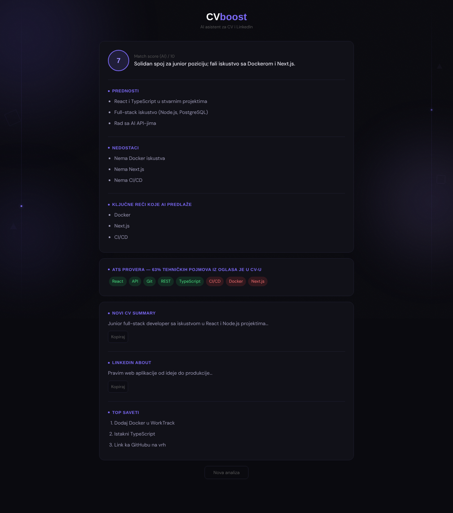

# CVBoost

**AI CV analysis against a specific job ad** — match score, strengths and gaps, missing ATS keywords, a rewritten CV summary and a LinkedIn About section, in Serbian.



## What changed in v2

The first version called the Claude API directly from the browser with the API key embedded (base64-obfuscated) in the page, and "unlocked" paid content with a code that was also in the page source. Both are fundamentally insecure: anything shipped to the browser is public. v2 fixes the architecture:

| v1 | v2 |
|---|---|
| API key in front-end code | key only in a **serverless function** (`api/analyze.ts`), read from environment |
| No limits — anyone could drain the key | **rate limit** per IP (5 analyses / hour) and input size limits |
| Free-text model output parsed with regexes | **JSON output** validated and clamped by `parseAnalysis` (score 0–10, list sizes, required fields) |
| Model output inserted into the page as HTML | all output **escaped** (prevents HTML/JS injection) |
| Client-side unlock code | removed — the tool is free |
| pdf.js from CDN, one 46 KB HTML file | Vite + TypeScript modules, `pdfjs-dist` from npm |

**New:** an instant, deterministic **ATS keyword check** that runs locally without AI — it extracts technical terms from the ad (React, CI/CD, Next.js, REST…) and shows which ones are in the CV.

## Architecture

```
index.html            landing + app shell
src/main.ts           UI: PDF text extraction (in the browser), form, rendering
src/analysis.ts       prompt, response validation, ATS keyword coverage, HTML escaping — pure & tested
api/analyze.ts        Vercel serverless function → Claude API (key from env, rate limited)
test/                 Vitest unit tests
```

The CV PDF is parsed in the browser; only the extracted text is sent for analysis and nothing is stored.

## Run

```bash
npm install
npm test
npm run dev          # UI only (http://localhost:5173)
npx vercel dev       # UI + API function locally (needs ANTHROPIC_API_KEY in .env)
```

Deploy: import the repo in Vercel and set `ANTHROPIC_API_KEY` (and optionally `ANTHROPIC_MODEL`) in Environment Variables.

## Stack

TypeScript · Vite · pdf.js · Claude API · Vercel Functions · Vitest

---

Built by [David Marković](https://github.com/davidmarkovic952-dev).
